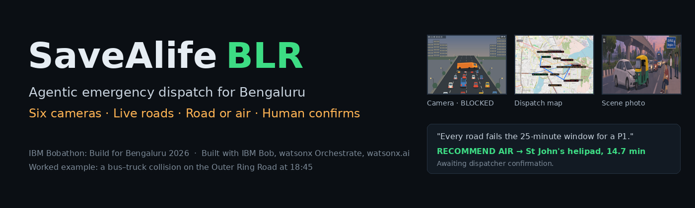
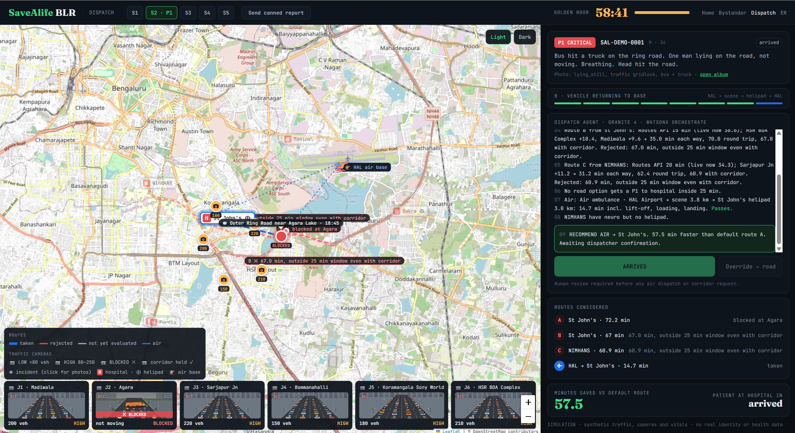
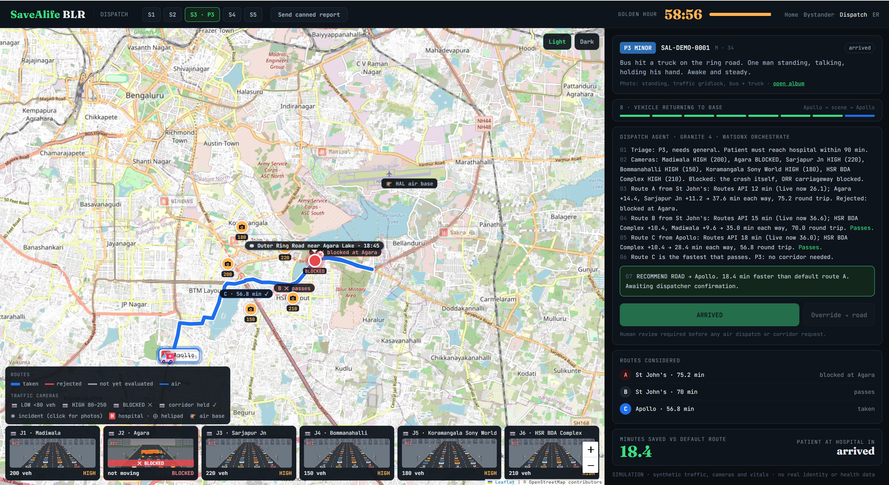
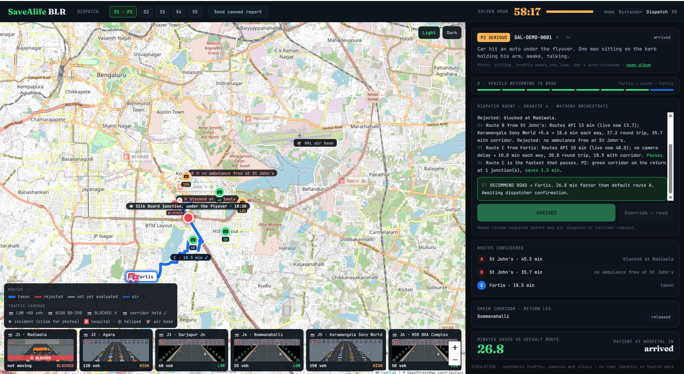
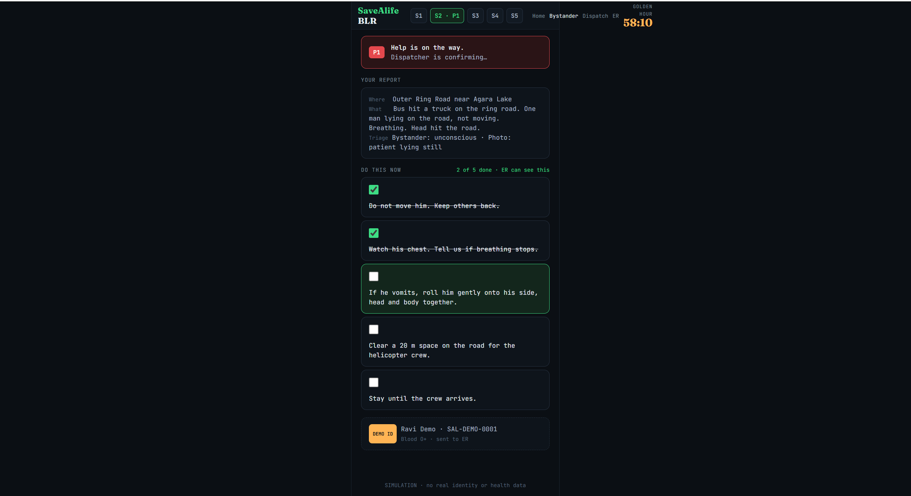
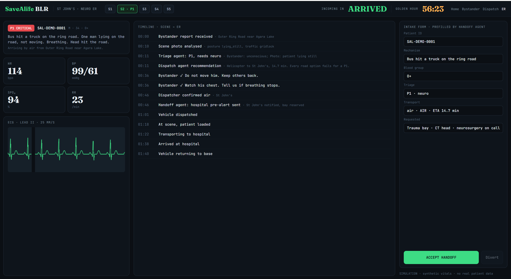

<p align="center"></p>

<p align="center"><b>An agentic dispatcher for road accidents: six traffic cameras and the live road network decide road or air, a rule owns the decision, a human owns the button, and the hospital is ready before the ambulance moves.</b></p>

<p align="center">
<a href="https://savealife-blr.2gwnl9m982ir.us-south.codeengine.appdomain.cloud"></a>
<a href="VIDEO_URL"></a>
<a href="docs/SaveAlife_BLR_Submission.pdf"></a>
<a href="bob_sessions/"></a>
</p>

<p align="center">


</p>

<p align="center"></p>

*Scenario S2. The crash itself blocks Agara; the other two roads are 60 and 67 minutes against a 25-minute window for a critical patient. Both the rule and the watsonx Orchestrate agent say air. Rejected routes stay on the map with their reason.*

A bystander stops at a crash and does not know what to do. A dispatcher has to pick a hospital and a route with no live picture of the roads. The ER learns about the patient when the doors open. SaveAlife BLR closes all three gaps: the bystander gets a checklist, the dispatcher gets a reasoned recommendation with every rejected option explained, the ER gets the patient from the moment of the report.

**Worked example:** a bus–truck collision on the Outer Ring Road at 18:45, five scenarios around it, four different hospitals. Built solo for the **IBM Bobathon: Build for Bengaluru 2026** (Theme 1, Smarter Streets Better Living), 7–8 November.

| What | Where |
| --- | --- |
| Live prototype | https://savealife-blr.2gwnl9m982ir.us-south.codeengine.appdomain.cloud |
| Demo video | VIDEO_URL |
| Submission document (PDF) | `docs/SaveAlife_BLR_Submission.pdf` |
| Bob sessions, one per task | `bob_sessions/` |

## Design principle

> The rule owns the decision. Cameras and the road network own the ground. The agent owns the explanation. The dispatcher owns the button.

A deterministic rule decides what is rejected and what is taken. Every number traces to a camera count, a Routes API time, or a hospital record. The watsonx Orchestrate agent is handed the same five tools and the same rule, reasons independently, and is shown beside the rule with an *agrees / differs* chip. Nothing moves before a human clicks Confirm.

## How a decision works

```
bystander report ────► triage ────► P1 / P2 / P3  +  neuro / trauma / ortho / general
scene photo ─────────► vision model (watsonx.ai) ──► posture · traffic · vehicles
                                      │
   six cameras  LOW / HIGH / BLOCKED ──┤
   Routes API   geometry + live time ──┼──► rule ──► road from <hospital> via <route>, or AIR
   six hospitals  specialty · helipad ─┤               │
   ambulances free this scenario ──────┘               ├──► watsonx Orchestrate agent, same tools, own answer
                                                        │
                                            dispatcher confirms  ──►  vehicle moves, hospital pre-alerted
```

1. **Triage.** Unconscious or not breathing → P1; bleeding or a limb injury → P2; otherwise P3. The scene photo can only raise severity. Windows: P1 25 min, P2 45, P3 90.
2. **Cameras.** Six fixed junctions. LOW under 80 vehicles; HIGH 80–250, delay in proportion to the count; BLOCKED, lane closed or stalled — any route through it is rejected outright.
3. **Routes.** Three per scenario, each to a named hospital, on real road geometry with a Routes API base time and the live time beside it. The ambulance leaves *from* the hospital and returns *to* it; the ETA is the round trip. P1/P2 get a green corridor on the return, 1.5 min per junction.
4. **Hospitals.** Six real ones with specialties and a helipad flag. Usable only with the needed specialty and a free ambulance.
5. **Decide.** Fastest route that passes. None and P1 → helicopter, HAL → scene → nearest helipad hospital with the specialty. None and P2/P3 → fastest usable road, delay flagged. A P3 never gets a helicopter.
6. **Confirm.** Both panels on screen, Override air → road available, then a sixty-second sequence the dispatcher and the ER both watch.

**Measured:** 50 tests assert every scenario's decision; the live Orchestrate agent matches the rule 5/5 at about ten seconds a run.

## In pictures

Same crash, same cameras, same route timings — opposite answers, because the patient is different:

| S2 · lying on the road, not moving · P1 | S3 · standing and talking · P3 | S1 · stalled truck at Madiwala · P2 |
| --- | --- | --- |
|  |  |  |
| *Helicopter: HAL → St John's helipad, 14.7 min* | *Road from Apollo, 56.8 min, no corridor* | *A rejected (blocked), B rejected (no ambulance), C to Fortis* |

The agent explains itself, and a human decides:

| Rule trace | Orchestrate agent | Routes considered |
| --- | --- | --- |
|  |  |  |
| *Every camera, every route, every rejection reason* | *gpt-oss-120b over the same five tools — "agrees with rule"* | *One line per option; Confirm executes the rule* |

## Screens

Three pages, one FastAPI app, one active incident. Pick a scenario on any of them.

<details>
<summary><b>Dispatch</b> — the judge's view: map, cameras, two reasoning panels, Confirm, the eight-step sequence</summary>


Real Bengaluru map on OpenStreetMap tiles with a light/dark toggle. Incident pin (click for the photo album), six camera icons coloured by state with a looping clip per state along the bottom, hospitals with helipad marks, all candidate routes on real roads — grey until evaluated, then blue for the taken route, red dashed with a reason for the rejected ones. After Confirm: incident pulses → hospital highlights → route highlights → vehicle leaves the hospital → loads at the scene → returns with corridor junctions turning green → arrives → returns to base. Minutes saved and patient-at-hospital countdown on the right.
</details>

<details>
<summary><b>Bystander</b> — phone-sized: report, photo, severity, checklist</summary>



Prefilled location, what happened, how many hurt, awake / breathing / bleeding. One tap adds one of five scene photos; it is analysed on the server and never shown to the hospital. After sending: severity badge, ETA line, a first-aid checklist whose ticks appear on the ER timeline, and a cartoon demo ID card that stands in for identity.
</details>

<details>
<summary><b>ER</b> — vitals, ECG, timeline, prefilled intake, Accept Handoff</summary>



The ER has had the patient since the report: severity and need, live vitals and a scrolling ECG, the timeline from report through triage, confirmation, each bystander tick, dispatch, scene, transport and arrival; an intake form prefilled by the handoff step; Accept Handoff closes the loop.
</details>

## A five-minute tour

1. **S2** (1 min). Dispatch → S2 → *Send canned report*. Read the rule trace while the Orchestrate panel fills. Confirm. Watch the helicopter go HAL → scene → St John's. Click the incident for the album.
2. **S3** (1 min). Same crash. Standing patient. Road from Apollo. No helicopter.
3. **S1** (40 s). Blocked junction. Watch A get rejected and the Fortis ambulance go.
4. **S5** (1 min). Corridor on the return; cameras clear mid-trip; the ETA drops in the trace and on the ER screen.
5. **ER and Bystander** (40 s). Open both; tick a checklist item on the phone; see it on the ER timeline.
6. **Bob** (40 s). `bob_sessions/` — four exports; `pytest -q` — 50 passed.

## The five scenarios

| | Where · when | Cameras | Patient | Decision | Saved vs default route |
| --- | --- | --- | --- | --- | --- |
| **S1** | Silk Board · 18:30 | Madiwala **BLOCKED**, two HIGH | Sitting, holding his arm · **P2 ortho** | Road from **Fortis** via C | 13.6 min |
| **S2** | ORR near Agara · 18:45 | Agara **BLOCKED**, five HIGH | Lying still, head injury · **P1 neuro** | **Air** to **St John's** helipad, 14.7 min | 57.5 min |
| **S3** | identical to S2 | identical to S2 | Standing, talking · **P3 general** | Road from **Apollo** via C, no corridor | 5.2 min |
| **S4** | Hosur Road · 06:10 | all LOW | On his side, not responding · **P1 neuro** | Road from **NIMHANS** via A, corridor anyway | 0 (A is the default) |
| **S5** | Sarjapur Road · 17:50 | four HIGH, two clear mid-trip | Can't move his leg · **P2 ortho** | Road from **Manipal** via B, corridor; ETA revised live | 3.0 min |

Savings are scenario-modelled on synthetic traffic, against the time a distance-only dispatcher would have committed to. In S1–S3 that default route is blocked: the default dispatch would not have arrived at all.

## How it uses IBM

| Technology | Job in SaveAlife BLR |
| --- | --- |
| **watsonx Orchestrate** | The dispatch agent, `savealife_dispatch`: a native agent with five OpenAPI tools served by this app — `get_incident`, `get_cameras`, `get_routes`, `get_hospitals`, `get_air_option`. Called on every report through the runs API; its text and verdict shown beside the rule. |
| **watsonx.ai · Granite 4 H Small** | Triage of the bystander's text. |
| **watsonx.ai · Llama 4 Maverick** | Reads the scene photo: posture, traffic density, vehicles. |
| **IBM Cloud Code Engine** | Hosts the app from source at a public HTTPS URL; Orchestrate calls its tools there. |
| **IBM Bob 2.0** | Built the deployment, the tools, the agent and the wiring — four tasks, four exported sessions. |

**The agent and Granite — an honest note.** The agent was specified on Granite 4 H Small. With Orchestrate's `react` style every run returned the generic "I did not understand" in six seconds, 39 completion tokens, empty step history; `react_core` the same; `default` style, "LLM has responded with empty message". `orchestrate models list` marks Granite as not recommended for agents; the recommended models are gpt-oss-120b, Claude Sonnet and Gemma. The agent was moved to gpt-oss-120b — Orchestrate's default, and what IBM's own stock agents in the instance use — and passed 5/5 on the first run. The diagnostic that found this is `scripts/wxo_diag.py`. Granite still does the triage text.

## Bob built the IBM layer

The screens and the simulation engine were hand-built and tested first so Bob had a stable codebase to extend. Each task was one written spec, pasted once; debugging happened outside Bob so each session is a clean record. Exports in `bob_sessions/`.

| Task | Bob produced | Tests after |
| --- | --- | --- |
| 1 Deploy | Dockerfile, `.dockerignore`, Code Engine deploy script | 19 |
| 2 Tools | Five stateless tool endpoints with LLM-facing descriptions that worked first time; OpenAPI exporter; import script; 29 tests | 48 |
| 3 Agent | `dispatch_agent.yaml` with the rule as instructions; import script; five-scenario harness against the Orchestrate REST API; follow-up fixed the chat endpoint | 48 · agent 5/5 |
| 4 Wiring | Background agent call on every report; rule stays ground truth; dispatch panel with agrees/differs chip. Bob caught that its own local import would defeat the test's monkeypatch and fixed it before reporting | 50 |

Bobcoins used: **N** of 50.

## Data: what is simulated and what is not

- **Real:** road geometry and live times for all fifteen routes (Google Routes API, fetched once, cached in `data/routes_cache.json`); hospitals, specialties, helipads, junction locations; the agent, the tools, the deployment, the confirm gate; token and compute costs.
- **Simulated, labelled on screen:** camera counts and states, the three camera clips; the patient, vitals, ECG; twenty-five scene photos — illustrations with no faces, plates or wounds; which hospitals have a free ambulance per scenario; vehicle movement on a sixty-second clock.
- No real person appears. No government ID, health record or children's data. The scene photo never leaves the server; only the structured read is forwarded.

## Setup

```
python -m venv .venv ; .venv\Scripts\activate       # Windows; source .venv/bin/activate elsewhere
pip install -r requirements.txt
copy .env.example .env                               # SIMULATION=true needs no keys
uvicorn app.main:app --reload                        # http://127.0.0.1:8000/
pytest -q                                            # 50 tests
```

With keys in `.env`: `python scripts\preflight.py` checks IAM, both watsonx.ai models with a live call each, Orchestrate, Routes and the credit balance; `python scripts\fetch_routes.py` pulls real road geometry; `AGENT_LIVE=true` turns on the Orchestrate panel.

## Public demo on Code Engine

```
ibmcloud login --apikey <key> -r us-south -g Default
ibmcloud ce project select --name savealife-blr
ibmcloud ce app update --name savealife-blr --build-source . --port 8080 --env-from-file .env
```

`.ceignore` keeps the venv and `.env` out of the upload. Orchestrate side: `scripts\wxo_import_tools.ps1`, `scripts\wxo_import_agent.ps1`, `python scripts\wxo_test_agent.py`.

## Evaluation

| Check | Result |
| --- | --- |
| Full flow, every scenario, expected decision (mode, route, hospital) | 5 / 5 |
| S2 vs S3: identical A/B route timings, opposite modes | pass |
| Override air → road keeps a valid route and logs it | pass |
| S5 re-evaluates on the return leg; ETA falls; trace and timeline record it | pass |
| Eight animation phases in order | pass |
| Blocked route rejected with "blocked at Madiwala" | pass |
| Five tool endpoints × five scenarios | 25 / 25 |
| Agent wiring with the agent mocked, success and failure paths | pass |
| **Total** | **50 passed** |
| Live Orchestrate agent, five scenarios, RECOMMEND AIR/ROAD as expected | **5 / 5**, 10–12 s each |

Cost per decision: about 1,600 tokens on the agent, under 1,000 on watsonx.ai — a fifth of a US cent. IBM Cloud credit consumed: $0.00.

## Project layout

```
app/
  main.py                   FastAPI entry; / → /ui/
  config.py                 settings from .env
  routers/api.py            incident flow: new · report · photo · confirm · checklist · handoff
  routers/tools.py          five stateless tools for the agent              (Bob 2)
  services/sim.py           scenarios, triage, cameras, rule, phases, vitals
  services/watsonx.py       Granite text + vision over REST
  services/wxo_agent.py     Orchestrate runs API client                      (Bob 4)
  services/routes_api.py    Routes API fetch, polyline decode, cache
  static/                   bystander.html · dispatch.html · er.html · app.js · style.css · img/ · video/
data/scenarios.json         hospitals, junctions, five scenarios, camera states, routes, checklists
data/routes_cache.json      real road geometry and live times
orchestrate/                tools_openapi.json (Bob 2) · dispatch_agent.yaml (Bob 3)
scripts/                    preflight · fetch_routes · wxo_import_tools · wxo_import_agent · wxo_test_agent · wxo_diag · deploy_ce (Bob 1)
tests/                      50 tests
bob_sessions/               four exported Bob sessions
docs/                       hero, screenshots, submission PDF
```

## Built during the hackathon (7–8 Nov 2026)

Everything in this repository was written during the hackathon window. The commit history shows the timeline.
